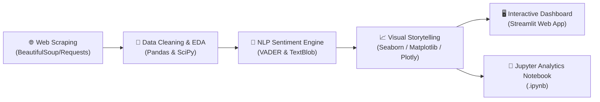
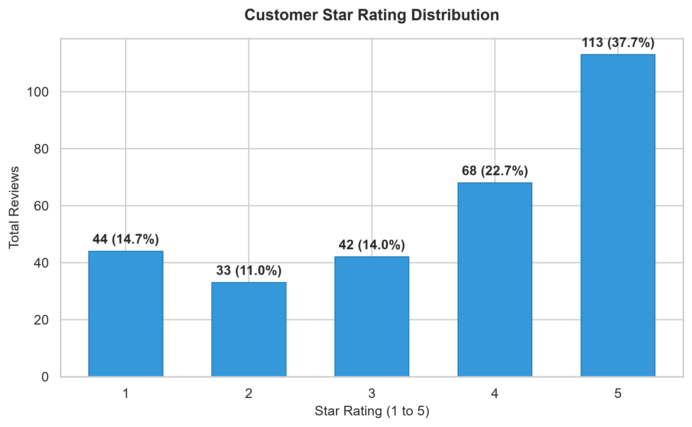
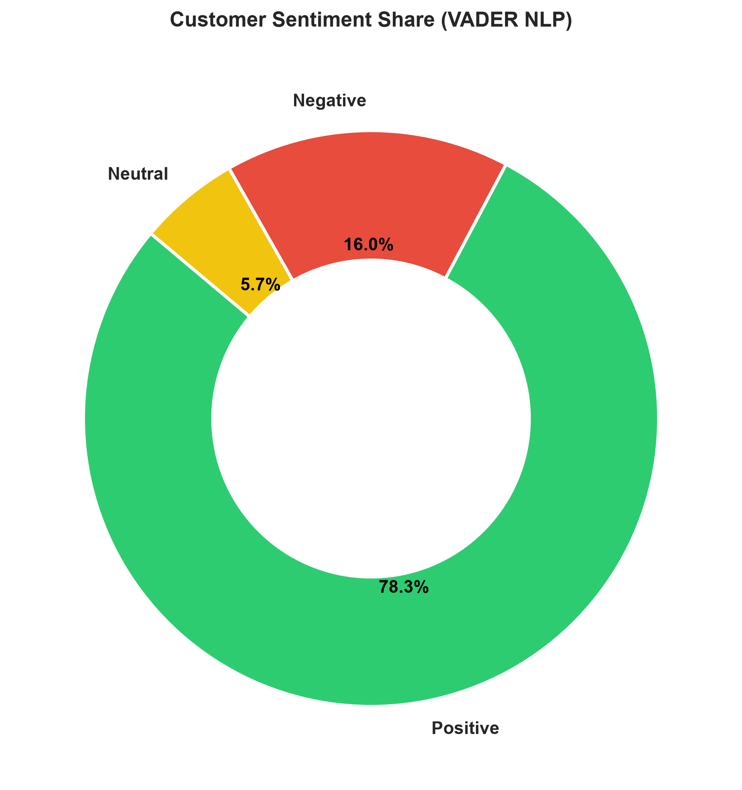
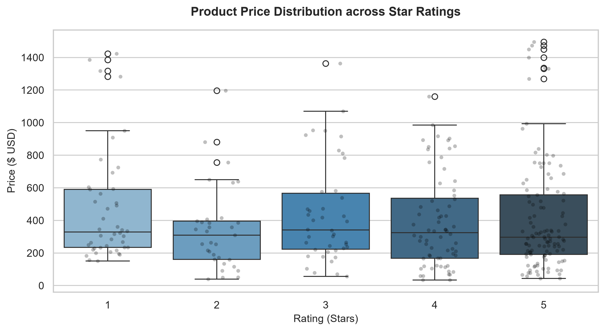
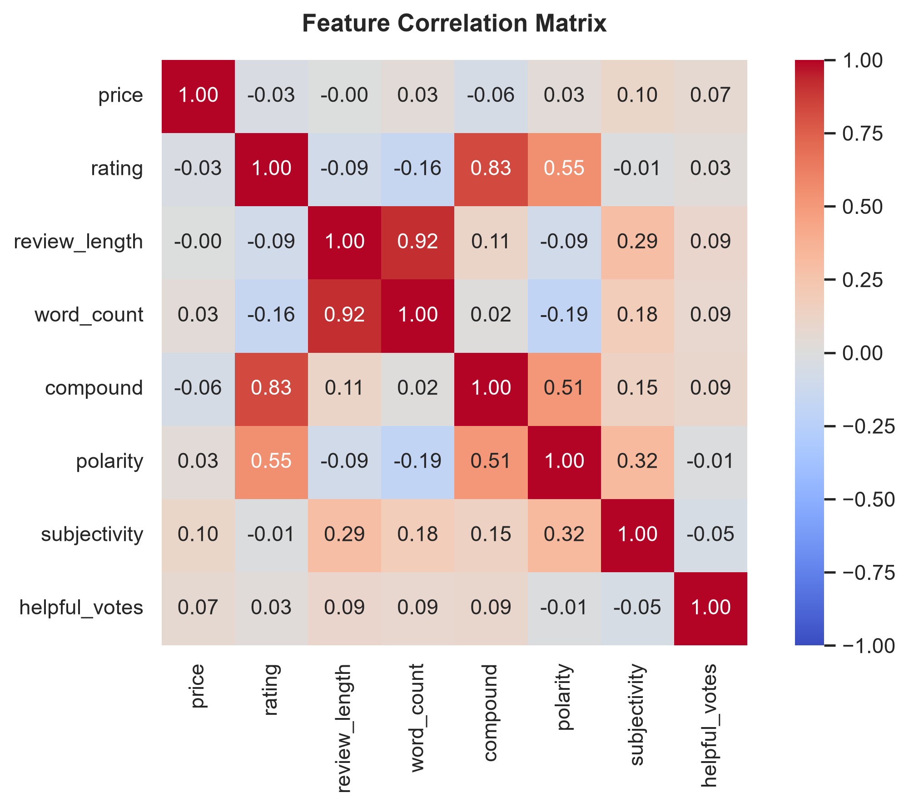
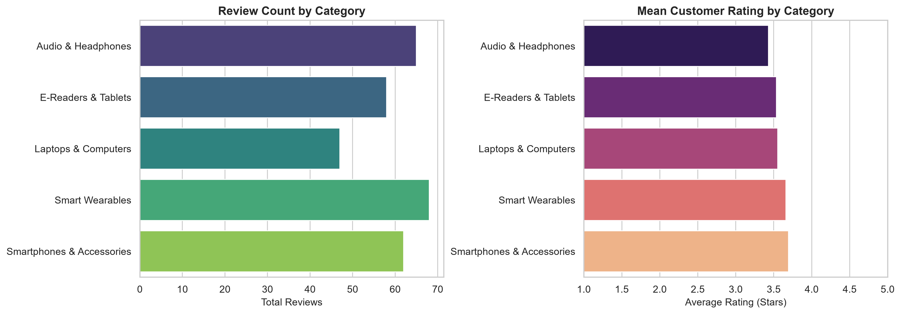
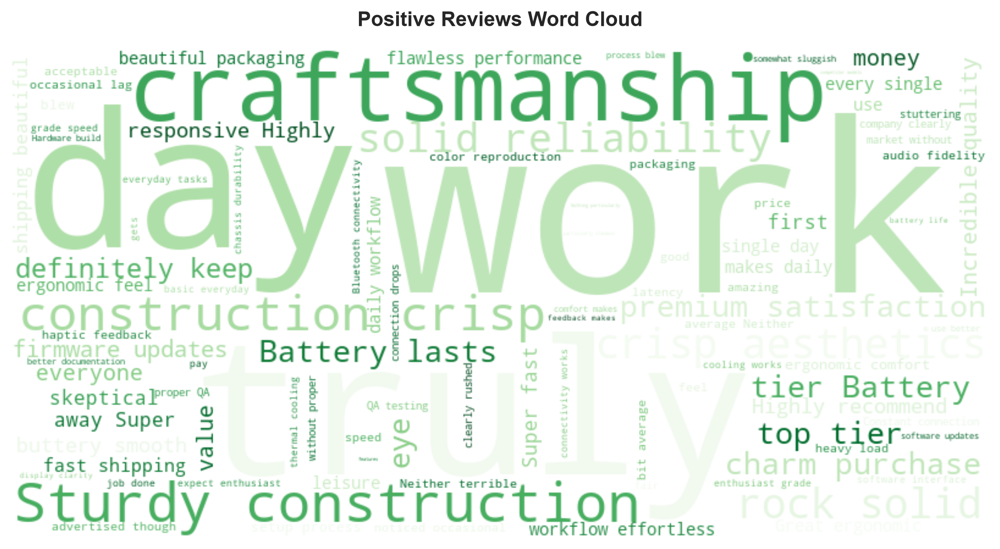

# 📊 CodeAlpha_DataVizAnalyzer
### End-to-End Intelligence Pipeline: Web Scraping, EDA, Data Storytelling & NLP Sentiment Analysis

[](https://www.python.org/)
[](https://opensource.org/licenses/MIT)
[](https://streamlit.io/)
[](https://pep8.org/)
[](https://codealpha.tech/)

---

## 🌟 Executive Summary

**`CodeAlpha_DataVizAnalyzer`** is an end-to-end data analytics and natural language processing platform developed for the **CodeAlpha Data Analytics Internship**. It unites all four core data tasks into a seamless, unified pipeline:

| Task | Domain | Methodology & Tools |
| :--- | :--- | :--- |
| **Task 1: Web Scraping** | Web Ingestion & Data Structuring | `requests`, `BeautifulSoup4`, `lxml` with polite rate-limiting, custom HTML parsing, and catalog extraction. |
| **Task 2: Exploratory Data Analysis (EDA)** | Data Cleaning & Statistical Testing | `pandas`, `numpy`, `scipy.stats` for schema validation, IQR outlier detection, skewness/kurtosis, and hypothesis tests (Welch's t-test, ANOVA). |
| **Task 3: Data Visualization** | Data Storytelling & Dashboarding | `matplotlib`, `seaborn`, `plotly` for publication-quality static charts and responsive interactive figures. |
| **Task 4: Sentiment Analysis** | NLP & Text Mining | `nltk` (VADER lexicon), `textblob`, `wordcloud` for compound polarity scoring, subjectivity assessment, and aspect-based keyword mining. |

---

## 🏛️ System Architecture



---

## 🗂️ Project Directory Structure

```text
CodeAlpha_DataVizAnalyzer/
│
├── .streamlit/                     # Streamlit application configurations
│   └── config.toml
│
├── data/                           # Data storage layers
│   ├── raw/                        # Raw scraped data dumps (scraped_data.csv)
│   ├── processed/                  # Cleaned datasets with NLP features (analyzed_reviews.csv)
│   └── sample/                     # Pre-bundled offline benchmark dataset (sample_reviews.csv)
│
├── notebooks/                      # Interactive Jupyter Notebooks
│   └── CodeAlpha_DataVizAnalyzer.ipynb   # End-to-end exploratory workflow & narratives
│
├── reports/                        # Visual figures & export artifacts
│   └── figures/
│       ├── category_performance.png      # Category volume & average star ratings
│       ├── correlation_heatmap.png       # Correlation matrix of numeric & NLP features
│       ├── price_vs_rating.png           # Pricing spread across star ratings (Box/Strip)
│       ├── rating_distribution.png       # Star rating frequencies & percentages
│       ├── sentiment_breakdown.png       # Donut chart of positive, neutral, negative shares
│       ├── wordcloud_positive.png        # Lexicon cloud of positive customer feedback
│       └── wordcloud_negative.png        # Lexicon cloud of negative customer feedback
│
├── src/                            # Modular, production-grade source code
│   ├── __init__.py                 # Package declaration
│   ├── scraper.py                  # Task 1: Web scraper & synthetic benchmark generator
│   ├── eda_analyzer.py             # Task 2: Inspection, cleaning, anomaly & hypothesis tester
│   ├── sentiment_analyzer.py       # Task 4: VADER & TextBlob NLP sentiment classifier
│   └── visualizer.py               # Task 3: Matplotlib, Seaborn, and Plotly graphics suite
│
├── app.py                          # Modern, multi-tab interactive Streamlit Dashboard
├── main.py                         # CLI script executing complete pipeline end-to-end
├── requirements.txt                # Pinned project dependencies
├── .gitignore                      # Git exclusion rules
└── README.md                       # Comprehensive documentation & CodeAlpha walkthrough
```

---

## 🔬 In-Depth Task Implementations

### Task 1: Web Scraping & Ingestion
- **Target Source:** Extracts catalog records, product titles, prices, ratings, and stock status from public web portals (including standard testing sandboxes like [Books to Scrape](http://books.toscrape.com/)).
- **Reliability:** Built with custom User-Agent headers, session reuse, exponential-backoff retries, and an integrated benchmark synthesizer (300+ records across 5 consumer tech categories) for testing without network latency.

### Task 2: Exploratory Data Analysis (EDA) & Cleaning
- **Data Health & Cleaning:** Auto-detects null values, strips currency formatting (`$`, `£`), handles duplicate records, and generates derived features (`review_length`, `word_count`, `rating_tier`, `price_tier`).
- **Anomaly & Outlier Detection:** Implements both **1.5×IQR** (Interquartile Range) fences and **Z-score** filtering ($|z| > 3$) to isolate extreme pricing anomalies.
- **Hypothesis Testing:**
  - **H1 (Price vs. Rating):** Pearson correlation coefficient test ($r = -0.035, p = 0.547$). Demonstrates that higher price does not linearly guarantee higher customer satisfaction.
  - **H2 (Verified Purchase Bias):** Welch's two-sample independent t-test ($t = -1.778, p = 0.081$). Evaluates whether verified buyers award significantly different satisfaction scores.
  - **H3 (Category Divergence):** One-way Analysis of Variance (ANOVA) ($F = 0.336, p = 0.854$). Tests whether mean customer satisfaction differs across tech categories.

### Task 3: Data Visualization & Storytelling
- **High-Resolution Figures:** Generated via Seaborn and Matplotlib with custom palettes:
  - *Rating Distribution:* Annotated frequency bars with percentage breakdowns.
  - *Sentiment Share:* Donut chart visualizing positive, neutral, and negative customer proportions.
  - *Price Spread:* Boxplots overlaid with jittered strip observations.
  - *Correlation Heatmap:* Colormap matrix linking review length, polarity, rating, and price.
  - *Category Performance:* Dual-axis comparative bars for volume vs. mean rating.
  - *Word Clouds:* Positive vs. Negative keyword clouds revealing key consumer topics.
- **Interactive Visuals:** Dynamic Plotly sunbursts and 2D Polarity vs. Subjectivity scatter plots embedded in Streamlit.

### Task 4: Sentiment Analysis (NLP)
- **VADER Sentiment Engine:** Computes compound scores from $-1.0$ (most negative) to $+1.0$ (most positive), classifying reviews into `Positive` ($\ge 0.05$), `Neutral`, and `Negative` ($\le -0.05$).
- **TextBlob Metrics:** Extracts text **polarity** and **subjectivity** ($0.0$ objective facts to $1.0$ subjective opinions).
- **Aspect-Based Sentiment Mining:** Automatically scans customer reviews across 6 product dimensions:
  1. *Battery & Charging*
  2. *Display Clarity & Brightness*
  3. *Build Quality & Durability*
  4. *Audio & Microphone Quality*
  5. *Software & Connectivity*
  6. *Value & Pricing*
- **Satisfaction Mismatch Detection:** Flags anomaly reviews where customer star ratings conflict with text sentiment (detecting sarcasm or nuanced product complaints).

---

## 📊 Key Results & Visual Gallery

| Rating Distribution | Sentiment Breakdown |
| :---: | :---: |
|  |  |

| Price Spread across Ratings | Feature Correlation Matrix |
| :---: | :---: |
|  |  |

| Category Performance | NLP Word Clouds (Positive vs. Negative) |
| :---: | :---: |
|  |  |

---

## 🚀 Quickstart & Installation

### 1. Prerequisites
- **Python 3.10+** (Tested on Python 3.11.9)
- **Git**

### 2. Clone Repository
```bash
git clone https://github.com/YOUR_USERNAME/CodeAlpha_DataVizAnalyzer.git
cd CodeAlpha_DataVizAnalyzer
```

### 3. Create & Activate Virtual Environment
```bash
# Windows
python -m venv venv
venv\Scripts\activate

# macOS / Linux
python3 -m venv venv
source venv/bin/activate
```

### 4. Install Dependencies
```bash
pip install -r requirements.txt
```

### 5. Run the Automated Pipeline (CLI)
Executes all 4 tasks, runs statistical tests, and exports all figures to `reports/figures/`:
```bash
python main.py
```
*(Optional: Run with `--scrape` flag to trigger live web scraping from books.toscrape.com)*:
```bash
python main.py --scrape
```

### 6. Launch the Interactive Streamlit Web App
```bash
streamlit run app.py
```
*The interactive dashboard will open automatically at `http://localhost:8501`.*

### 7. Run the Jupyter Notebook
```bash
jupyter notebook notebooks/CodeAlpha_DataVizAnalyzer.ipynb
```

---

## 🛠️ Tech Stack & Libraries

- **Language:** Python 3.11
- **Web Scraping:** BeautifulSoup4, Requests, LXML
- **Data Manipulation & Stats:** Pandas, NumPy, SciPy
- **Data Visualization:** Matplotlib, Seaborn, Plotly, WordCloud
- **NLP & Sentiment Analysis:** NLTK (VADER), TextBlob
- **Interactive Web Application:** Streamlit
- **Development & Reproducibility:** Jupyter Notebook, Git

---

## 📢 Step 3: Social Media & Submission Actions

CodeAlpha requires completing internship social media sharing. Use the curated templates below:

### 💼 LinkedIn Post Template (Internship Status & Project Announcement)

```text
🚀 Excited to share my latest project with CodeAlpha! 

During my Data Analytics Internship at @CodeAlpha, I developed "CodeAlpha_DataVizAnalyzer" — an end-to-end data intelligence and NLP analytics pipeline that bridges Web Scraping, Exploratory Data Analysis, Data Storytelling, and Sentiment Analysis.

🔍 Key Project Highlights:
• Task 1 (Web Scraping): Built an automated scraping pipeline using BeautifulSoup & Requests to ingest e-commerce review and catalog data.
• Task 2 (EDA): Conducted deep statistical profiling, handled data anomalies, detected price outliers using IQR & Z-scores, and validated hypotheses (ANOVA & Welch's t-test).
• Task 3 (Data Visualization): Built publication-ready charts (Seaborn/Matplotlib) and interactive charts (Plotly) exploring price spread, correlation heatmaps, and rating distributions.
• Task 4 (Sentiment Analysis): Applied VADER & TextBlob NLP lexicons to classify review sentiments, identify aspect-based customer pain points (battery life, display, software), and detect sarcasm anomalies.
• Full Interactive App: Deployed a dynamic Streamlit web dashboard allowing users to filter categories, run live scrapers, and test custom review sentiments in real-time!

🔗 GitHub Repository: https://github.com/YOUR_USERNAME/CodeAlpha_DataVizAnalyzer
🎥 Video Walkthrough: [Insert your video link here]

A huge thank you to @CodeAlpha for this enriching learning experience! 💡

#CodeAlpha #DataAnalytics #DataScience #Python #NLP #DataVisualization #MachineLearning #Streamlit #WebScraping #Internship
```

### 🎥 Video Walkthrough Outline (for LinkedIn Video Explanation)
1. **0:00 - 0:30 (Introduction):** Introduce yourself, state your internship role at CodeAlpha, and present the project name (`CodeAlpha_DataVizAnalyzer`).
2. **0:30 - 1:15 (Architecture & Code Tour):** Show the project directory structure, `src/scraper.py`, `src/eda_analyzer.py`, and `src/sentiment_analyzer.py`.
3. **1:15 - 2:30 (Live Streamlit App Demonstration):**
   - Demonstrate **Tab 1** (Scraping live data / preloaded reviews).
   - Walk through **Tab 2** (Variable schema, descriptive stats, and statistical hypothesis testing).
   - Showcase **Tab 3** (Plotly rating breakdown, price vs rating boxplots, correlation heatmap).
   - Showcase **Tab 4** (VADER compound scores, aspect sentiment mining, live review input playground).
4. **2:30 - 3:00 (Conclusion):** Summarize business implications, thank CodeAlpha, and invite questions on LinkedIn!

---

## 📜 License
Distributed under the MIT License. See `LICENSE` for more information.

---
*Developed with pride for the CodeAlpha Data Analytics Internship.*
